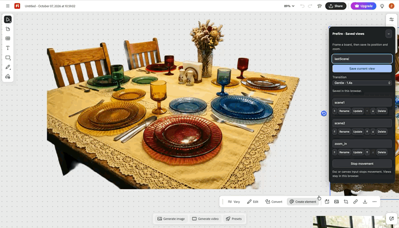
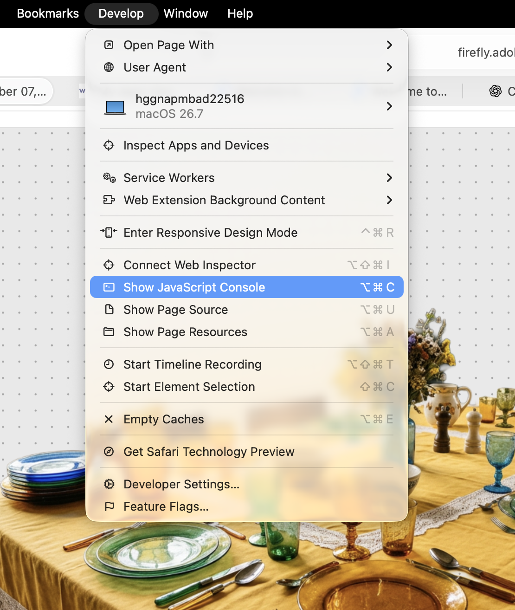
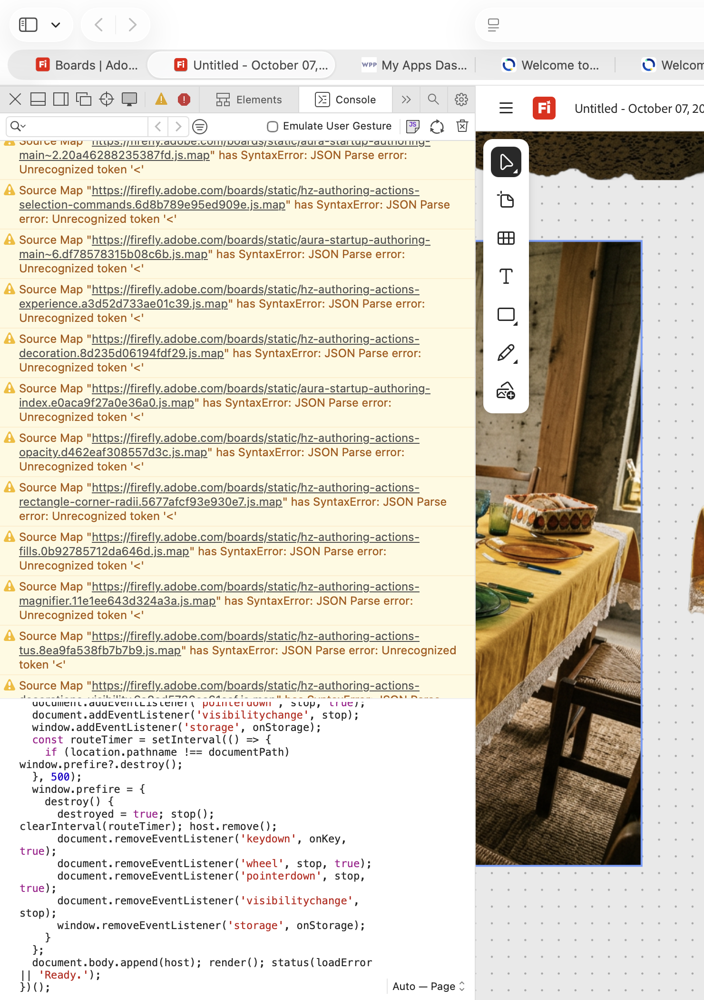
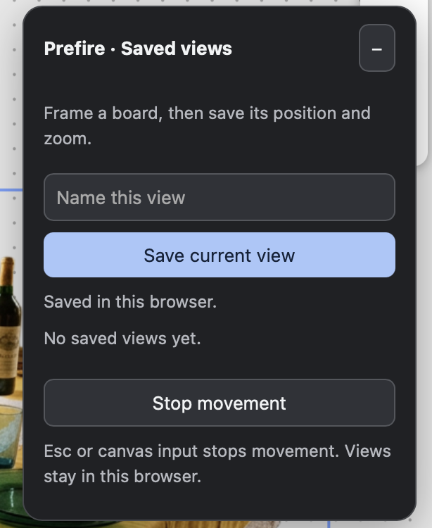
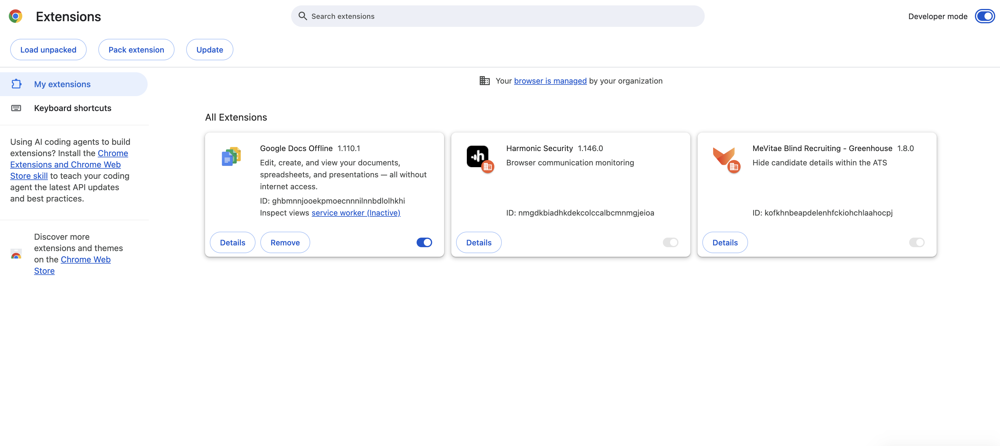

# Prefire

Save views in Adobe Firefly Boards and move smoothly between them. Frame each board once, save its position and zoom, then return with one click. (Could break at anytime whenever Adobe firefly updates)

## Demo

[](docs/videos/prefire-demo.mp4)

[Watch the Prefire screen recording](docs/videos/prefire-demo.mp4)

## Run the console script

No extension installation is needed. Use [prefire-console.js](prefire-console.js) with a Firefly board open.

### Safari

First, enable the **Develop** menu:

1. In Safari, choose **Safari → Settings…** (`Command + ,`).
2. Open the **Advanced** tab.
3. Enable **Show features for web developers**. In older Safari versions, this is called **Show Develop menu in menu bar**.
4. Close Settings. **Develop** now appears in Safari’s menu bar.

Then run the script:

1. Open [prefire-console.js](prefire-console.js), choose **Raw** if viewing it on GitHub, and copy the entire script.
2. Open your board in Firefly and wait for it to load.
3. Choose **Develop → Show JavaScript Console** (`Option + Command + C`).



4. Paste the script into the Console input at the bottom and press **Return**.



5. The **Prefire · Saved views** panel appears over the canvas. You can close the Console and use the panel.



### Chrome

The same [prefire-console.js](prefire-console.js) script works in Chrome; no extension is required.

1. Open [prefire-console.js](prefire-console.js), choose **Raw** if viewing it on GitHub, and copy the entire script.
2. Open your board at **firefly.adobe.com** and wait for it to load.
3. Open **View → Developer → JavaScript Console** on Mac, or **⋮ → More tools → Developer tools → Console**. Keyboard shortcuts: **Option + Command + J** on Mac or **Ctrl + Shift + J** on Windows/Linux.
4. Paste the script into the Console input next to **`>`**, then press **Enter**. Paste only the JavaScript, without Markdown code fences.
5. The **Prefire · Saved views** panel appears over the canvas. Close DevTools, frame a board, enter a name, and click **Save current view**.

If Chrome blocks pasting with a self-XSS warning, review the script first and follow the instructions Chrome displays to enable pasting.

To remove the panel without refreshing, run this in the Console:

```js
window.prefire?.destroy();
```

Removing the panel does not delete saved views.

Rerun the script after refreshing or opening another document. Running it again replaces the existing panel without deleting saved views.

## Use saved views

1. Pan and zoom until a board is framed the way you want.
2. Enter a name and click **Save current view**.
3. Repeat for other boards, then click a saved name to move to that view.

- **Transition:** choose **Smooth** (0.7s), **Gentle** (1.4s with softer starts and stops), **Snappy** (0.35s with a fast start), or **Instant** before clicking a saved view.
- **Reorder:** drag the **⠿** handle. A blue line shows where the view will land. The arrow buttons also move views up or down.
- **Rename:** change a view’s name.
- **Update:** replace a saved view with your current position and zoom.
- **Delete:** remove a saved view after confirmation.
- **Stop:** press **Esc**, interact with the canvas, or click **Stop movement**.
- **Minimize:** click the minus button in the panel header to shrink it into a compact Prefire bar. Click **+** to restore the full panel.

Transitions respect your system’s reduced-motion preference. Saved views are camera bookmarks; they do not follow boards that are moved later.

## Share your saved order

1. Arrange your saved views in the order you want and choose a transition style.
2. Click **Export views** to download `prefire-saved-views.json`.
3. Send that file and the Firefly document link to your teammate. They need access to the document and either the console script or the extension.
4. Your teammate opens the **same Firefly document**, clicks **Import views**, and selects the JSON file.

Import restores the names, camera positions, zoom levels, order, and transition style. If there are existing saved views, it asks before replacing them. Export first if you want to keep a backup. Files work between the console script and Chrome extension, including across browsers. They do not grant access to the Adobe document or update automatically when you change your sequence.

## Try-on plugin (Chrome extension)

The extension includes an optional **Try-on · Batch generation** section. Choose a model reference and clothing images once, then start a batch with **Generate N try-ons**. It generates one image per garment using the same person. Supported categories are tops, bottoms, and one-piece outfits; shoes and accessories are outside this version.

Try-on uses [FASHN v1.6 through fal.ai](https://fal.ai/models/fal-ai/fashn/tryon/v1.6/api), rather than Adobe generation. Clicking Generate sends the selected images to that service and uses **paid fal credits**, separate from Adobe credits. No generation starts just by scanning or uploading images. The console script continues to provide saved views only.

### Start the local generation service

1. Create a fal API key with access to FASHN v1.6 and available credits.
2. From the repository folder, run the following with Python 3.10 or newer (no additional Python packages needed):

   ```sh
   export FAL_KEY="your-fal-api-key"
   python3 server/tryon.py
   ```

3. Keep the terminal open. The service listens only on `127.0.0.1:8765` and prints a **local service token**. The fal API key stays in the service environment; do not paste it into Prefire.
4. Reload the updated extension at `chrome://extensions`, then refresh your Firefly board.
5. Open **Try-on → Service settings**, paste the local service token, and click **Save token & connect**.

The extension needs localhost host permission to contact this service. The extension ZIP contains the extension only; download the repository to run `server/tryon.py`.

### Generate a batch

1. Click **Scan board**. This reads candidate image references from Firefly's internal board data, including offscreen data when exposed. **The scan is experimental and cannot guarantee a complete inventory.** Check the thumbnails and add missing clothing images with the multiple-file uploader. Scans preserve previous selections; removed board assets may remain in this list until you remove them.
2. Choose a board image as the model reference or upload a model photo. Model references are excluded from the clothing batch. Uploaded photos are resized to at most 1280 pixels and compressed to JPEG locally.
3. Select the clothing images to generate. Choose a category per garment or leave **Auto category**. A scan does not classify images as clothing; use the checkboxes to exclude non-clothing images, thumbnails, and earlier results. **Select all clothing** selects all listed images except the chosen model reference, so review the list first.
4. Click **Generate N try-ons**. N is the number of paid generations to request; no fixed cost estimate is provided. Check the provider's current pricing before a large batch. Jobs run sequentially.
5. Results appear in the Try-on gallery. Use **Open / download result**, save the image, then import it into your Firefly board manually. **Automatic board insertion is not implemented** because no insertion interface has been verified.

Use **Pause after current** to stop new submissions; the in-flight generation finishes and can still incur a charge. Use **Resume batch** to continue, or **Cancel remaining items** to remove queued work while allowing the current generation to finish. Refreshing or changing documents pauses processing; reopening the original board restores the batch and checks existing job IDs instead of automatically submitting again. Keep one Prefire tab per document while working on a batch.

Failed items have **Retry this item**, which explicitly starts another paid request. If submission was interrupted or uncertain, check fal's request history before retrying. Transient service/status errors pause the batch so Resume can retrieve the same job. Public HTTPS source URLs must be accessible to the provider; for private, expired, or blob URLs, upload the original image file instead.

Each document stores one batch gallery locally in Chrome. Starting a new batch replaces the old gallery after confirmation, so download results first. Provider result URLs may expire. Up to 300 items and 7 MB of deduplicated image data are supported per document; browser storage is shared across documents. Remove items or use smaller uploads if storage fills. The service stores job handles and result URLs in `server/jobs.sqlite3`; keep that database across service restarts to preserve duplicate-submission protection. Source image data is sent to fal but is not stored in the service database. By default, restarting the service prints a new local token; update Prefire settings, or set `PREFIRE_TOKEN` to a persistent token in your environment.

### Development checks

```sh
python3 -m unittest discover -s tests -p 'test_tryon.py'
python3 tests/check-tryon.py
python3 tests/check-sharing.py
node --test tests/page.test.cjs
python3 scripts/package.py
```

The JavaScript check scripts use macOS JavaScriptCore through `osascript`. Automated tests cover job persistence, duplicate prevention, uncertain submissions, credential boundaries, image validation, queue snapshots, and inventory traversal. Live Firefly scanning and paid provider output still require testing in an actual board with a configured fal account.

## Where views are saved

The console script saves views locally in this browser, separately for each Firefly document. Refreshing preserves them; clearing Firefly site data removes them. They are not automatically synced between people or browsers; use Export and Import to share them. The script does not send data to a server.

To share the tool internally, send colleagues **prefire-console.js** and the instructions above. Each person can save their own views or import your exported sequence.

## Chrome extension

For automatic loading, use the extension instead:

1. Download [prefire-0.1.0.zip](dist/prefire-0.1.0.zip) and unzip it into a folder you will keep on your computer.
2. Open `chrome://extensions` in Chrome.
3. Enable **Developer mode** in the upper-right corner.
4. Click **Load unpacked** and select the extracted folder containing `manifest.json`. If you downloaded the whole repository instead, select its [extension](extension) folder.
5. Reload Firefly and open a board. The **Prefire · Saved views** panel appears automatically.



To update, replace the files in the installed extension folder with the new version, click **Reload** on Prefire’s card in `chrome://extensions`, and refresh Firefly. Keep the same folder and installation to preserve saved views.

To disable or remove the extension, use its toggle or **Remove** button in `chrome://extensions`.

The extension stores views in local Chrome extension storage. Its saved views are separate from the console script’s, and uninstalling the extension removes them. The extension package is Chrome-only; the console script can be run in Safari as shown above.

To create a distribution ZIP:

```sh
python3 scripts/package.py
```

The ZIP is written to `dist/prefire-0.1.0.zip`. Testers should unzip it and load the extracted folder through **Load unpacked**. Company browser policies may restrict this installation method.

## Troubleshooting

- **Camera not found:** wait for the board to finish loading, then rerun the script.
- **Panel disappears after refresh:** rerun the console script, or use the Chrome extension for automatic loading.
- **Saved view is outdated:** frame the board again and click **Update**.

COULD BREAK AT ANYTIME
